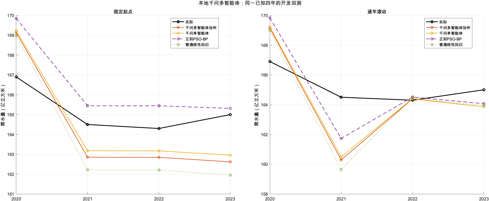
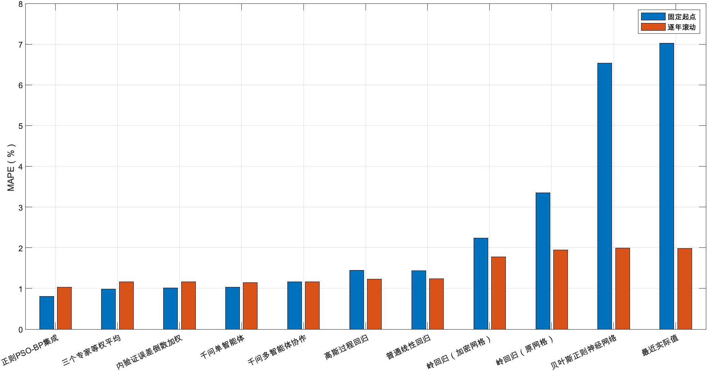

# 本地千问多智能体需水预测

本方法实际复用了羽毛球项目中的 **mlx-community/Qwen3-VL-4B-Instruct-4bit**，通过MLX执行纯文本推理。使用同一份模型权重扮演不同角色，按顺序调用，没有重新训练千问。

```text
训练前缀数值模型工具：PSO-BP / GPR / OLS
             ↓ 内验证误差、训练输入方向诊断
精度审查员 ─┐
稳定性审查员 ├→ 协调者 → 三模型非负权重 → 代码计算需水量
节水情景员 ─┘
```

三名审查员独立读取本折证据，协调者读取证据和三份意见。一折4次调用；五折20次调用。另有五次单智能体调用做消融，共保存25次最终运行的真实推理。单智能体与协调者使用相同职责和证据，但不读取三位审查员意见。

## 实测结果

**同一2020—2023开发回测，已经参与模型探索，不是新增独立测试。** 固定起点权重仅由2019及以前证据决定；滚动每年重新用当时前缀决策；2023全历史决策用于未来情景。两种检验复用同四年。

| 方案 | 固定MAPE (%) | 滚动MAPE (%) | 两项均值 (%) |
|---|---:|---:|---:|
| 千问多智能体协作 | 1.168009 | 1.162950 | 1.165479 |
| 千问单智能体 | 1.031350 | 1.147436 | 1.089393 |
| 内验证误差倒数加权 | 1.008871 | 1.164686 | 1.086779 |
| 三个专家等权平均 | 0.985247 | 1.166116 | 1.075681 |

作为参照，PSO-BP为0.805875% / 1.035417%；OLS为1.438028% / 1.236283%。

多智能体相对单智能体的两项MAPE均值增加0.076086个百分点。排序以实际结果为准，多智能体不保证超过单智能体、规则加权或单个数值专家。

| 多智能体检验 | MAPE (%) | MAE | RMSE | MSE |
|---|---:|---:|---:|---:|
| 固定起点 | 1.168009 | 1.930803 | 1.969861 | 3.880353 |
| 逐年滚动 | 1.162950 | 1.921955 | 2.454561 | 6.024870 |

## 运行

先在项目根目录用MATLAB导出数值专家证据。此步骤复用已有数值实验和已保存模型，仅重新拟合很小的OLS；如需更换源数据，先运行main_ThreeMethodComparison生成对应模型。

```matlab
addpath('05_Multi_Agent');
B = prepare_agent_evidence;
```

在终端使用现有羽毛球环境和模型（路径可自行指定）：

```sh
WATER_AGENT_PYTHON="$HOME/Desktop/羽毛球论文/04_原型/.venv-vision/bin/python"
WATER_QWEN_MODEL="$HOME/Desktop/羽毛球论文/04_原型/models/vision/Qwen3-VL-4B-Instruct-4bit"
HF_HUB_OFFLINE=1 TRANSFORMERS_OFFLINE=1 "$WATER_AGENT_PYTHON" \
  05_Multi_Agent/run_agents.py --model-path "$WATER_QWEN_MODEL"
python3 tests/test_Multi_Agent.py
```

如没有原环境，使用Apple Silicon、Python 3.12独立环境安装requirements.txt，并准备同版MLX权重后传入--model-path。运行器设置local_files_only=True；不会在运行中自动下载模型。用--output指定目录可以保留另一轮输出。

在MATLAB中生成图表：

```matlab
addpath('05_Multi_Agent');
plot_agent_results;
```

## 结果文件

- [完整报告](results/结果报告.md)：全部模型排序、逐年预测、协调者解释与未来方向检查。
- [result.json](results/result.json)：4种策略的误差、权重、预测及105点未来情景。
- [trace.json](results/trace.json)：25次推理的完整提示、原始回复、归一化决策与耗时。
- [training_evidence.json](results/training_evidence.json)：唯一交给千问的5折前缀证据。
- [evaluation_bank.json](results/evaluation_bank.json)：单独保存的检验答案、专家预测及未来数值预测；所有决策落盘之后才读取。
- [decisions.json](results/decisions.json)：冻结的逐折权重。
- [runtime.json](results/runtime.json)：实际模型配置/权重SHA256、MLX版本与解码设置。
- [verification.json](results/verification.json)：真实推理回放、指标重算、证据范围和结果复现的测试记录。





## 解释范围

千问输出用JSON Schema约束，代码检验有限非负权重并归一化；非法输出会报错，不会偷偷改成规则预测。原始回复保留在trace.json。即使格式有效，理由中仍可能误读误差或方向计数；协调者意见是模型原文，以数值证据和重算误差为准。

固定起点四年共用一份权重；没有看到某个检验年份误差后再修改该年的权重。模型本身和本实验方案是在已知数据上开发，未据此声称盲测或显著优越。

权重不是农业、工业、生活用水贡献率；这是需水预测与情景审查工作流，没有供水能力约束、区域博弈和实际水库调度优化。千问没有取代数值预测模型。

## 技术来源

- [MLX-VLM官方项目](https://github.com/Blaizzy/mlx-vlm)
- [所复用量化模型](https://huggingface.co/mlx-community/Qwen3-VL-4B-Instruct-4bit)
- [Qwen原模型](https://huggingface.co/Qwen/Qwen3-VL-4B-Instruct)
